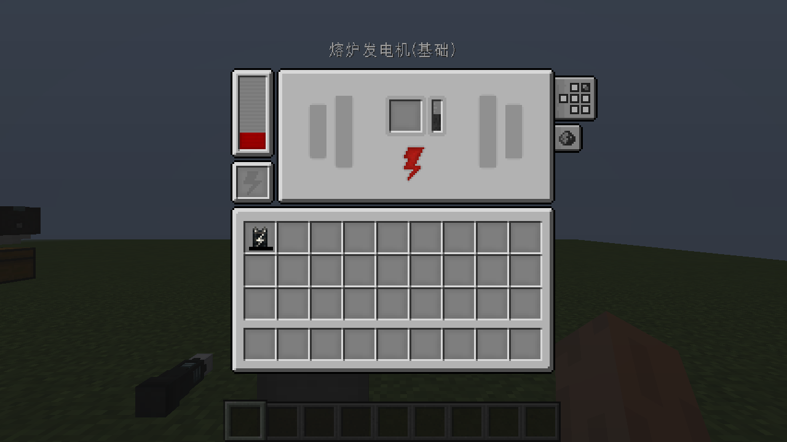
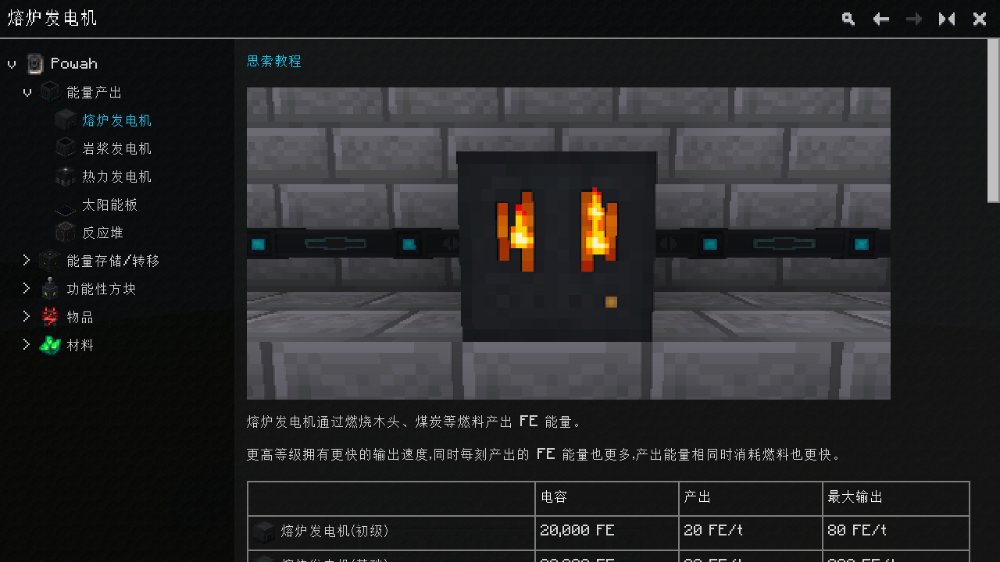
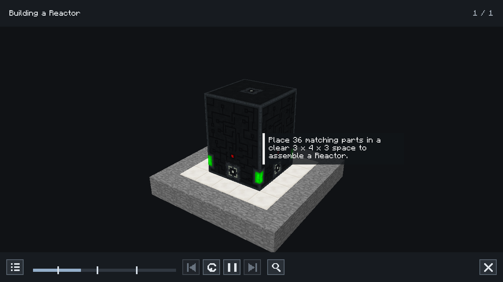

# Powah Legacy

[](https://github.com/mcyudream/powah-legacy/actions/workflows/ci.yml)
[](https://github.com/mcyudream/powah-legacy/releases)


<!-- legacy-overview:start -->
将 [Powah](https://github.com/Technici4n/Powah) 的分级 FE 能源玩法带到 **Minecraft 1.12.2 / Cleanroom / Java 25**：从发电机、线缆和储能开始，逐步解锁充能材料、反应堆、跨维度末影能源网络和玩家充电设备。

当前版本：**`5.1.0-cleanroom-alpha.2`（Alpha）**。最低运行基线是 **Cleanroom `0.4.0` 正式版，不带 `-alpha`**；Mod 版本中的 `alpha` 表示本移植的发布阶段。

**[下载发行版](https://github.com/mcyudream/powah-legacy/releases/tag/v5.1.0-cleanroom-alpha.2)** · [更新说明](docs/releases/5.1.0-cleanroom-alpha.2.md) · [问题反馈](https://github.com/mcyudream/powah-legacy/issues) · [安装包验收](LEGACY-VERIFICATION.md)

## 安装

| 组件 | 版本 / 要求 |
| --- | --- |
| Minecraft | **1.12.2** |
| Cleanroom | 最低 **0.4.0 正式版**；本版已在该版本完成客户端及专服验收 |
| Java | **25** |
| Powah Legacy | `powah-legacy-5.1.0-cleanroom-alpha.2.jar` |
| Ponder Legacy（可选） | [1.4.0-cleanroom-alpha.1](https://github.com/mcyudream/ponder-legacy/releases/tag/v1.4.0-cleanroom-alpha.1) |
| CraftTweaker（使用 Ponder 时） | **4.1.20.698**，按 [Ponder 安装说明](https://github.com/mcyudream/ponder-legacy)独立安装 |

将普通运行 JAR 放入客户端和服务器的 `mods/`，替换本项目旧 JAR。`-sources.jar` 供开发阅读源码。发行页同时提供 `SHA256SUMS`。

核心机器、配方、手册和存档只需 Cleanroom；Ponder 与 CraftTweaker 为独立安装的可选教程依赖。机器和手册 UI 已包含在 Powah 内，无需另装 Lollipop 或现代 GuideME。

加载器 Mod ID 为 **`powah-legacy`**；物品、方块、资源和场景仍使用 **`powah`** 命名空间。保留命名空间不构成其他 Powah 实现的存档转换承诺。

## 功能与本地化

- **107 个方块、38 个独立物品**，共 145 个物品注册项。
- 入门、基础、硬化、烈焰、钻石、绿宝石、终极七个等级，以及创造能量单元。
- 熔炉、熔岩、热力、太阳能发电机，36 部件的晶质铀反应堆。
- 能量单元、混合等级线缆、充能球与充能棒。
- 按玩家 UUID 和频道持久保存的末影单元、末影门及跨维度能源网络。
- 电池、绑定卡、玩家能量发射器、能量漏斗、放电器、扳手及晶质铀矿物。
- **156 个工作台配方、14 个充能配方**，以及粗晶质铀熔炼配方。
- **553 个英文 / 简体中文语言键**，覆盖全部物品名称、机器 UI、提示、手册和 Ponder 讲解；**28 篇双语手册**。

## 机器界面与指导手册

**机器界面使用固定上游版本的原始 GUI 贴图，并按其槽位、仪表和按钮坐标回迁。** 六面配置、红石模式、末影频道、反应堆自动模式和流体交互均可操作。线缆按点击面打开紧凑配置界面。

**手册按上游使用的 GuideME 21.1.7 布局与原素材回迁到 1.12。** 保留目录、插图、参数表、真实工作台配方、搜索、历史前进 / 后退、全宽切换及小窗口侧栏；中文搜索和界面缩放已验证。该实现不提供现代 GuideME 的完整扩展 API。

右键使用手册打开，按 **Ctrl + F** 搜索。界面尺寸、来源和更多截图见 [UI 对齐记录](docs/UI.md)。

<details>
<summary>查看正式 CR 0.4.0 实机截图</summary>







</details>

## 开始游玩

1. 用 3 份煤、2 份黏土球和一桶熔岩合成 24 份绝缘膏；空桶会返还。
2. 一本书加一份绝缘膏，无序合成使用手册。
3. 建立“发电机 → 线缆 → 能量单元”。默认一块煤产生 48,000 FE，一桶熔岩产生 100,000 FE。
4. 将铁锭和金锭分别放入充能球，从充能棒贴附面供能；消耗 10,000 FE 得到 2 个充能钢。后续等级依靠各类充能水晶推进，见 [充能配方表](docs/ENERGIZING.md)。
5. 反应堆需要 36 个相同部件及 3 × 4 × 3 空间，点击底部中心自动搭建。拆除任意部件会拆解整座结构，返还部件和内部物品，并保留能量、流体及燃料状态。

手册包含发电条件、冷却材料、能源端口、末影频道、绑定卡与自动化操作说明。

## 可选 Ponder 教程

安装 Ponder Legacy 和 CraftTweaker 后，悬停相关物品并按住 **W**，或点击手册中的“思索教程”。

| 教程 | 展示内容 |
| --- | --- |
| 发电与储存能量 | 燃料、发电机、线缆、储能和其他发电条件 |
| 充能合成材料 | 放入原料、充能棒供电、取出成品与循环 |
| 建造反应堆 | 分层搭建、铀燃料、冷却和能源输出位置 |
| 无线末影网络 | 扩容、所属玩家、频道和末影门供能 |
| 物品与玩家充电 | 绑定卡、跨维度升级、能量漏斗、放电器和随身电池 |

兼容代码隔离于 `owmii.powah.compat.ponder`。仅客户端检测到 **`ponder-legacy`** 后注册插件，Ponder API 使用编译期可选依赖；未安装 Ponder 时仍可正常使用核心玩法。场景、NBT 结构和翻译使用 `powah` 命名空间，进入世界后刷新结构缓存以适配存档切换。

## 与上游的具体差异

上游基线是 Minecraft 1.21.1 的 Powah `5.1.0-alpha`，具体来源见文末。

| 项目 | 本 Legacy 版本 |
| --- | --- |
| 运行平台 | 使用 1.12 方块实体、容器、网络、世界生成和 Forge Energy 重写运行层。 |
| 材料体系 | 现代标签转矿物词典；青金石使用 `minecraft:dye:4`。9 个浮冰合成 `powah:blue_ice`，2 个蓝冰可充能为干冰。 |
| 世界生成 | 晶质铀矿和干冰适配新生成的主世界区块；深板岩矿保留注册，默认自然矿脉使用 1.12 石头地形。 |
| 能量接口 | 内部使用 `long` 保存能源，对外 Forge Energy 遵守 1.12 的 `int` 上限。 |
| 机器与手册 | 原机器 GUI 素材和坐标回迁；GuideME 阅读布局、素材与功能使用 1.12 API 实现。 |
| 教程 | 新增五类可选 Ponder 演示和手册跳转。 |
| 其他集成 | 标准工作台 / 熔炼配方可被查询；充能配方的专用 JEI 分类、Curios、EMI 和现代 GuideME 扩展 API 未回迁。 |

能量漏斗支持原版容器及 `IItemHandlerModifiable`，仅对可安全写回的物品处理器操作。当前为 Alpha，大型整合包、长时间高负载能源网络及远程多人联机尚未完成全面组合测试。详见 [上游差异](docs/UPSTREAM-DIFFERENCES.md)。

## 配置

配置文件：`config/powah-legacy.cfg`。

| 键 | 默认值 | 用途 |
| --- | --- | --- |
| `energizingRange` | 4 | 充能棒寻找充能球的距离 |
| `energyPerFuelTick` | 30 | 熔炉燃料每燃烧刻对应的 FE |
| `energizingEnergyRatio` | 1 | 充能配方耗能倍率 |
| `productionRatio` | 1 | 发电产量倍率 |
| `worldGeneration` | true | 晶质铀矿和干冰生成 |

## 构建与 CI 发行

使用 Java 25，在源码目录执行：

```bash
python3 tools/bootstrap_legacy.py
bash gradlew --no-daemon :build :reobfJar --console=plain
python3 tools/verify_legacy_package.py
```

独立克隆时，脚本按 [build-dependencies.json](build-dependencies.json) 拉取固定提交的 Ponder 编译源码；工作区已有 `../ponder` 时使用相邻工程。首次构建会下载 Gradle、Minecraft 和 Cleanroom SDK。开发 SDK 为 `0.7.14-alpha`，**发行包的运行验收基线始终为正式 `0.4.0`**。

CI 在 push、PR 和手动触发时构建主源码、运行测试与资源检查、执行重混淆并检查包身份和可选依赖隔离。推送与包版本一致的 `v*` 标签后，额外强制核对验收 SHA-256 和四组运行报告，通过后自动发布 GitHub Release，附运行包、源码包及校验和；Alpha 标签发布为预发行版。

### 本地运行与验收

```bash
./tools/dev.sh runClient
./tools/dev.sh runClient -PwithPonder

# 生成独立测试夹具；测试代码不会进入发行包
./tools/dev.sh :build :reobfJar :reobfDevHarnessJar :reobfServerHarnessJar
python3 tools/verify-cleanroom.py client
python3 tools/verify-cleanroom.py client --with-ponder
python3 tools/verify-cleanroom.py server
python3 tools/verify-cleanroom.py server --with-ponder
```

`tools/dev.sh` 使用 Java 25，可通过 `POWAH_JAVA_HOME` 指定 JDK。正式安装包验证器适用于 Linux x64，使用官方 CR 0.4.0 安装器、游戏 JAR 和校验过的运行库；可通过 `LEGACY_PONDER_JAR` 指定被测 Ponder 发行包。专服测试使用本地临时端口，须先在测试目录接受 Minecraft EULA。报告位于 `build/reports/cleanroom-0.4.0-legacy/`。

资源重新导入与工具要求见 [import-report.json](docs/import-report.json)、[upstream-lock.json](upstream-lock.json) 和 [guide-ui-lock.json](guide-ui-lock.json)。普通构建使用已提交资源，无需再次导入。

## 运行验收与发布状态

正式 **Cleanroom 0.4.0 / Minecraft 1.12.2 / Java 25**，使用重混淆的生产安装包验收：

| 组合 | 结果 | 检查记录 |
| --- | --- | --- |
| 客户端，无 Ponder | PASS | 218 |
| 客户端，安装 Ponder 与 CraftTweaker | PASS | 218 |
| 专用服务器，无 Ponder | PASS | 8 |
| 专用服务器，安装 Ponder 与 CraftTweaker | PASS | 8 |

覆盖注册内容、配方、发电和能源网络、反应堆、真实 GUI 操作、双语手册、模型、存档重载与 Ponder 场景播放。检查记录数包含逐物品模型断言。各次运行的准确文件摘要、范围和限制见 [验收记录](LEGACY-VERIFICATION.md)；历史记录见 [验证索引](docs/VERIFICATION.md)。

本版包含仅对正式 CR 0.4.0 物理专服生效的 Kirino 发现兼容修复。验收直接使用官方加载器 JAR。

GitHub 为发行下载渠道。CurseForge / Modrinth 当前状态见 [PUBLICATION.md](PUBLICATION.md)，平台准备说明见 [发布说明](docs/PUBLISHING.md)。

<!-- legacy-authorship:start -->
## 作者与来源 / Authors and upstream

- 此 Legacy 版本作者与维护者 / Legacy author and maintainer：**yudream**。
- 原作者 / Original author(s)：**owmii (original), Technici4n and Powah contributors**。
- 原仓库 / Original repository：[Technici4n/Powah](https://github.com/Technici4n/Powah)。
- 上游基线：`1.21.1` 分支的 `5.1.0-alpha`；固定提交 [`959d5657b14f`](https://github.com/Technici4n/Powah/commit/959d5657b14fada803bc06b024acb5eef8156ab7)。
- 此版本独立维护。沿用上游 **LGPL-3.0**；版权、贴图和其他资源来源见 [LICENSE](LICENSE)、[NOTICE.md](NOTICE.md) 和 [GuideME 来源锁](guide-ui-lock.json)。
<!-- legacy-authorship:end -->

`branding/icon.png` 和 `branding/cover.png` 为本项目生成的展示插画；实机画面见上文截图。生成记录见 [图像来源](branding/provenance.json)，上游游戏资源仍遵循其原始授权。
<!-- legacy-overview:end -->
