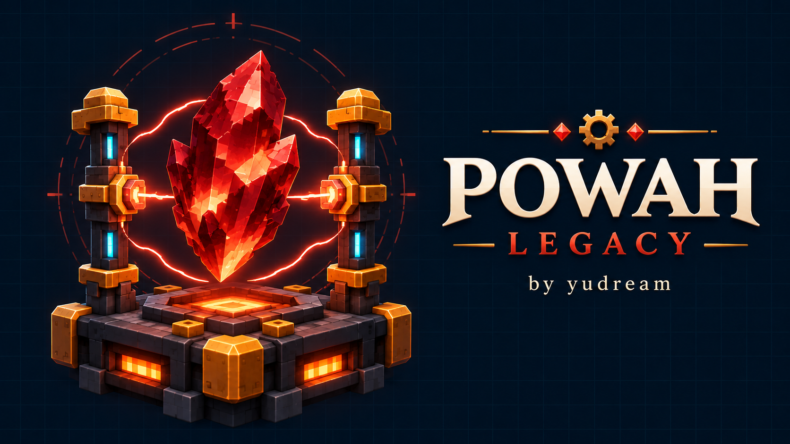

# Powah Legacy



<!-- legacy-overview:start -->
把 Powah 的分级 FE 能源体系带到 1.12.2：从基础发电与线缆开始，逐步解锁充能材料、反应堆、跨维度末影能源网络和玩家充电设备。

## 当前状态

> **公开仓库目前包含项目介绍、上游差异、图像与 CI 框架。Mod 源码尚未提交，等待对应迁移验收完成。CI 此时只报告 scaffold，没有执行 Mod 编译。**

当前为进行中的迁移或改名后验收阶段。构建通过、接口已导入和历史测试结果均不等于完整移植完成。当前源码提交与产物状态见 [PUBLICATION.md](PUBLICATION.md)；未通过验收的项目暂不提供成品发布。

<!-- legacy-authorship:start -->
## 作者与来源 / Authors and upstream

- 此 Legacy 版本作者与维护者 / Legacy author and maintainer：**yudream**。
- 原作者 / Original author(s)：**owmii (original), Technici4n and Powah contributors**。
- 原仓库 / Original repository：[Technici4n/Powah](https://github.com/Technici4n/Powah)。
- 上游基线：`5.1.0-alpha`。
- 固定上游提交：[`959d5657b14f`](https://github.com/Technici4n/Powah/commit/959d5657b14fada803bc06b024acb5eef8156ab7)。
- 本版本独立维护；上游版权、许可证及资源来源声明保留于 LICENSE / NOTICE 文件中。
<!-- legacy-authorship:end -->

## 运行环境与身份

| 项目 | 要求 / 标识 |
| --- | --- |
| Minecraft | 1.12.2 |
| 运行基线 | Cleanroom **0.4.0 正式版（不带 `-alpha`）** |
| Java | 25 |
| 加载器 Mod ID | `powah-legacy` |
| 资源与原注册命名空间 | `powah`（保留） |

Mod 的 alpha 版本号与加载器版本无关。开发 SDK 可以较新，兼容结论必须来自上述正式运行基线。
加载器身份改名后，安装时应替换本项目旧 jar；原资源命名空间的保留不构成跨实现的存档转换承诺。

## 功能与迁移范围

- 七个等级的发电、储能、线缆、充能球/棒与创造能量单元。
- 36 部件反应堆、末影单元与末影门、绑定卡、电池和玩家能源设备。
- 156 个工作台配方、14 个充能配方，以及中英文 28 篇使用手册。

## 与上游的具体差异

| 项目 | 上游基线 | 本 Legacy 版本 |
| --- | --- | --- |
| 运行平台 | Powah 5.1.0-alpha / Minecraft 1.21.1 | 使用 1.12 方块实体、容器、网络、世界生成和 Forge Energy 重写运行层。 |
| 材料体系 | 现代物品标签与蓝冰、深板岩地形 | 标签转矿物词典；青金石用 dye:4；新增可合成的 powah:blue_ice；自然矿脉适配 1.12 石头地形。 |
| 能量接口 | 现代能源实现 | 内部使用 long 保存能源；对外 1.12 Forge Energy 接口遵守 int 上限。 |
| 游戏内手册 | GuideME 21.1.7 | 回迁阅读布局、搜索、历史、插图与配方展示；不依赖现代 GuideME，也不提供其完整扩展 API。 |
| 渲染与教程 | 上游现代模型/界面与集成 | 转换模型和 GUI 坐标；新增五套可选 Ponder 演示，手册可跳转教程。 |
| 配方查看器 | 现代 Curios / EMI 等集成 | 标准工作台和熔炼配方可用；专用充能 JEI 分类、Curios 与 EMI 未回迁。 |

## 尚未实现与兼容边界

- 当前为 alpha；大型整合包、长时间高负载能源网络和远程多人联机仍需进一步验证。
- 能量漏斗只修改可安全写回的容器和 IItemHandlerModifiable，不写入只读处理器。
- 深板岩矿保留为可注册方块，但默认矿脉适配 1.12 世界；不表示移植现代世界生成系统。

## 依赖

- 核心玩法只需 Cleanroom。
- Ponder Legacy 可选，独立安装；启用时还需 CraftTweaker 4.1.20.698。

## 使用方式

1. 先合成绝缘膏与使用手册，再建立发电机→线缆→能量单元链路。
2. 用充能棒给充能球供能，按手册推进充能钢和各级水晶。
3. 使用末影单元的所属玩家/频道连接跨维度网络；反应堆按 3×4×3 空间自动搭建。

## 构建与 CI

源码提交后，使用 Java 25，在项目目录执行：

```bash
python3 tools/bootstrap_legacy.py
bash gradlew --no-daemon :build :reobfJar --console=plain
python3 tools/verify_legacy_package.py
```

CI 会准备固定版本的源码依赖，构建完整主源码与测试，并检查发行 jar 的身份、作者和图标。
仅有文档的仓库会明确报告 scaffold，不把跳过编译标为 Mod 构建成功。CI 构建不能替代客户端玩法和专服验收。

## 授权与图像

代码与上游资源按各自原始授权保留归属；见 LGPL-3.0 LICENSE、NOTICE.md、guide-ui-lock.json。

此版本作者为 **yudream**，上游作者与版权保留如上。`branding/icon.png` 和 `branding/cover.png` 为本项目生成的展示图，
以代表物品或概念表现项目；不作为游戏实机截图，也不改变上游游戏资源的授权。生成记录见 `branding/provenance.json`。

<!-- legacy-overview:end -->
