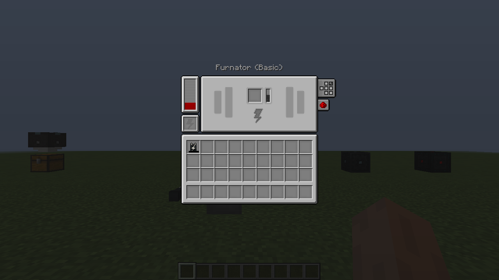

# UI 对齐记录

基线：Powah `1.21.1` 分支，固定提交 `959d5657b14fada803bc06b024acb5eef8156ab7`。使用上游 `assets/powah/textures/gui/container/` 及 `assets/lollipop/textures/gui/container/button_ov.png` 原始贴图。

坐标按上游 `client/screen/container/*Screen.java`、`client/screen/Textures.java` 和 `inventory/*Container.java` 还原。下表尺寸为 GUI 逻辑像素，实际显示遵循 Minecraft GUI 缩放。

| 界面 | 尺寸 | 还原内容 | 游戏截图 |
| --- | --- | --- | --- |
| 能量单元 | 176 × 141 | 横向储能表，左侧两个充电槽 | [截图](verification/releases/5.1.0-cleanroom-alpha.2/client-with-ponder/screenshots/ui-energy-cell-en.png) |
| 末影单元 / 末影门 | 176 × 164 | 青色储能表、等级解锁的频道直选、双充电槽、Shift 扩容 | [单元](verification/releases/5.1.0-cleanroom-alpha.2/client-with-ponder/screenshots/ui-ender-cell-en.png) / [门](verification/releases/5.1.0-cleanroom-alpha.2/client-with-ponder/screenshots/ui-ender-gate-en.png) |
| 熔炉发电机 | 176 × 166 | 储能表、燃料槽、燃烧余量和工作指示 | [英文](verification/releases/5.1.0-cleanroom-alpha.2/client-with-ponder/screenshots/ui-furnator-en.png) / [中文大缩放](verification/releases/5.1.0-cleanroom-alpha.2/client-with-ponder/screenshots/machine-zh-large-scale.png) |
| 熔岩发电机 | 176 × 166 | 储能表、流体材质和工作指示 | [截图](verification/releases/5.1.0-cleanroom-alpha.2/client-with-ponder/screenshots/ui-magmator-en.png) |
| 热力发电机 | 176 × 166 | 储能表、产量百分比、冷却液表 | [截图](verification/releases/5.1.0-cleanroom-alpha.2/client-with-ponder/screenshots/ui-thermo-en.png) |
| 晶质铀反应堆 | 176 × 166 | 五个物品槽、铀 / 碳 / 红石 / 冷却剂 / 温度表、流体表、自动模式开关 | [截图](verification/releases/5.1.0-cleanroom-alpha.2/client-with-ponder/screenshots/reactor-ui.png) |
| 太阳能板 / 能量漏斗 | 176 × 141 | 宽储能表和玩家背包 | [太阳能](verification/releases/5.1.0-cleanroom-alpha.2/client-with-ponder/screenshots/ui-solar-en.png) / [漏斗](verification/releases/5.1.0-cleanroom-alpha.2/client-with-ponder/screenshots/ui-hopper-en.png) |
| 放电器 | 176 × 166 | 宽储能表、七个放电槽 | [截图](verification/releases/5.1.0-cleanroom-alpha.2/client-with-ponder/screenshots/ui-discharger-en.png) |
| 玩家能量发射器 | 176 × 141 | 横向储能表、绑定卡槽、连接指示 | [截图](verification/releases/5.1.0-cleanroom-alpha.2/client-with-ponder/screenshots/ui-transmitter-en.png) |
| 能量线缆 | 153 × 29 | 点击面名称、传输模式图标和红石控制 | [截图](verification/releases/5.1.0-cleanroom-alpha.2/client-with-ponder/screenshots/ui-cable-en.png) |

机器标题位于面板上方；原版的六面配置图标位于右侧。容器与屏幕共享 `MachineLayout`，保持服务端槽位编号、客户端物品落点和背景槽框一致。高储能数字在空间不足时使用缩写，完整数值保留在悬浮提示中。

测试夹具在真实客户端中依次打开上述界面，点击红石、频道、全侧面及线缆按钮，并实际用桶注入 / 抽取流体。中文界面使用 GUI 缩放 4，其余机器截图使用缩放 2。完整结果见 [验证记录](VERIFICATION.md)。

## 使用手册

上游 Powah 1.21.1 使用 GuideME `21.1.7`。alpha.2 已将手册从原来的七页深蓝面板改为该版本的灰色阅读布局，并导入 Powah 原有 **28 篇英文 / 简体中文页面**与全部插图。

- 使用 GuideME 原始 `background.png` 与 `buttons.png`，资源及来源校验见 [guide-ui-lock.json](../guide-ui-lock.json)。
- 标题、分隔线、150 像素侧栏、青色链接、后退 / 前进、搜索、全宽切换、关闭和滚动条参照该版 GuideME 源码实现。小窗口收起侧栏，鼠标移至左边缘展开。
- 原始分章、插图、等级参数表、物品关联和工作台配方保留；容量、传输和产量取当前移植实现，配方读取实际 Forge 注册表。
- 添加七组已适配 1.12 的具体操作说明；安装 Ponder 时显示“思索教程”链接。
- 全部页面、补充说明及工具栏中英本地化；搜索支持中文。

这是 **GuideME 布局与素材的 1.12 回迁实现**，没有直接运行现代 GuideME，也不提供其任意扩展标签和渲染引擎。机器界面则保留上游原始容器贴图和坐标。

| 内容 | 截图 |
| --- | --- |
| 中文目录和使用说明 | [首页](verification/releases/5.1.0-cleanroom-alpha.2/client-with-ponder/screenshots/guide-zh.png) |
| 原版插图与参数表 | [中文](verification/releases/5.1.0-cleanroom-alpha.2/client-with-ponder/screenshots/guide-furnator-zh.png) / [英文](verification/releases/5.1.0-cleanroom-alpha.2/client-with-ponder/screenshots/guide-furnator-en.png) |
| 实际工作台配方 | [配方](verification/releases/5.1.0-cleanroom-alpha.2/client-with-ponder/screenshots/guide-recipes-en.png) |
| 搜索与大 GUI 缩放 | [中文搜索](verification/releases/5.1.0-cleanroom-alpha.2/client-with-ponder/screenshots/guide-search-zh-large-scale.png) / [反应堆](verification/releases/5.1.0-cleanroom-alpha.2/client-with-ponder/screenshots/guide-zh-large-scale.png) |
